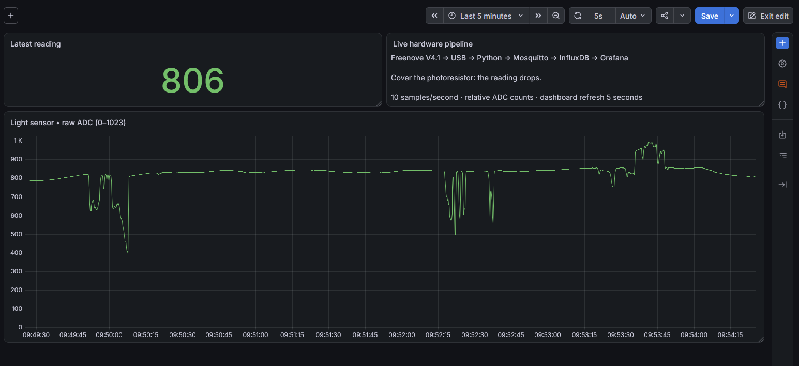
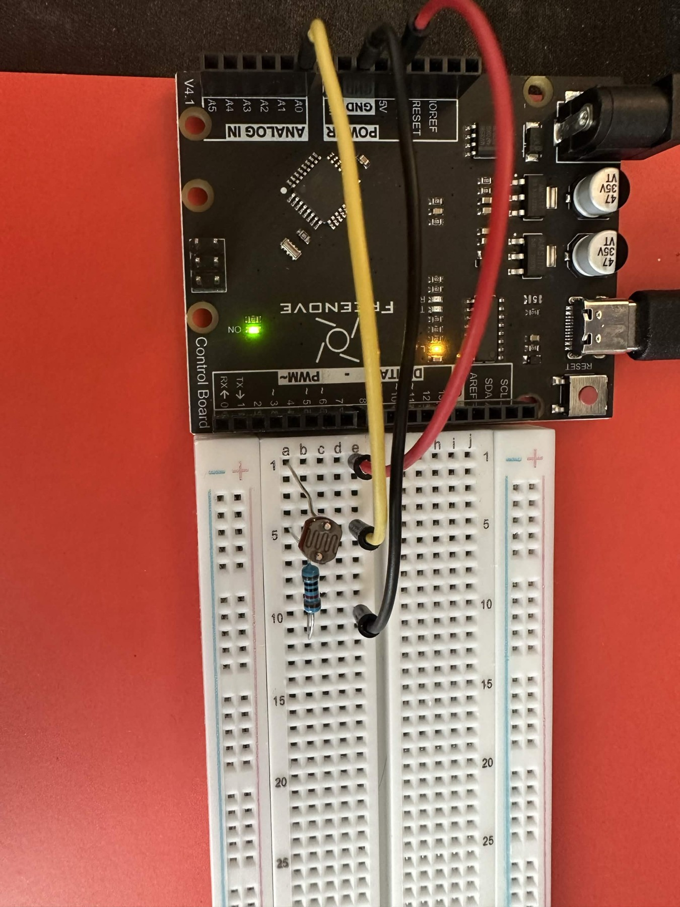

# Freenove Light Measurement Workstation

A physical light sensor connected to a monitoring pipeline:

**Freenove board → USB → Python → MQTT / Mosquitto → InfluxDB → Grafana**

The photoresistor changes resistance with ambient light. The board reads the resulting voltage at A0 and sends raw measurements over USB. The demonstrated pipeline stores those measurements and displays their response in Grafana.



The graph shows drops when the sensor is shaded and recovery when it is uncovered. This screenshot captures an earlier dashboard layout; the included dashboard also has sample-age and sampling-rate indicators.

## Hardware

| Part | Quantity |
| --- | ---: |
| Freenove UNO-compatible V4.1 board from the FNK0034E kit | 1 |
| Photoresistor / LDR | 1 |
| 10 kΩ resistor | 1 |
| Breadboard | 1 |
| Male-to-male jumper wires | 3 |
| USB data cable and computer | 1 each |

No Raspberry Pi, Wi-Fi module, or 3D printer is needed. The computer handles messaging, storage, and visualization.

## Wiring

Disconnect USB before assembling or changing the circuit.

```text
5V ── photoresistor ──┬── 10 kΩ resistor ── GND
                     │
                     A0
```

| Connection | Breadboard placement |
| --- | --- |
| Photoresistor legs | a1 and a5 |
| 10 kΩ resistor legs | b5 and b10 |
| Board 5V | e1 |
| Board A0 | e5 |
| Board GND | e10 |

Holes a–e in each numbered row are connected internally. The central gap separates those holes from f–j. Neither resistor has polarity.



With this divider orientation, more light raises the reading. The ADC returns values from **0 to 1023**. These are relative light measurements, not calibrated lux.

## Run the firmware

1. Install Arduino IDE and connect the board using USB.
2. Open `firmware/LightSensor/LightSensor.ino`.
3. Select **Arduino Uno** and the board's serial port.
4. Install **Arduino AVR Boards** if prompted, then upload.
5. Open Serial Monitor at **115200 baud**.
6. Cover and uncover the photoresistor; the reading should fall and recover.

The firmware sends one number per line, approximately ten times per second. Close Serial Monitor before another program opens the same USB serial port.

## Dashboard and demonstrated pipeline

The demonstrated setup used Python 3.14.6, Arduino IDE 2.3.11, Mosquitto 2.1.2, InfluxDB OSS 2.10.0, and Grafana OSS 13.3.1.

Python read the USB measurements and published timestamped JSON to `freenove/light/raw`. A separate subscriber stored the readings in InfluxDB and CSV. Grafana queried the database every five seconds.

This repository contains the **firmware, dashboard export, dependency list, and physical build evidence**. The Python acquisition programs and service configuration are not included in this version; the dependency list alone does not recreate the full pipeline.

To reuse the dashboard with an existing pipeline:

1. Send integer readings to InfluxDB 2 using bucket `light_readings`, measurement `light`, field `raw`, and device tag `freenove-v4.1`.
2. Configure a Flux data source in Grafana with UID `freenove-influx`.
3. Import `grafana/light-dashboard.json`.
4. Use a recent relative time range and enable the five-second refresh.
5. Cover the sensor for 3–5 seconds, then uncover it and observe the response.

The time-series graph shows the size and duration of changes. A current-value display shows the newest reading, while sample age and sampling rate help identify interrupted acquisition.

## Observed results

Initial physical checks showed approximately **760 ADC uncovered** and **250–600 ADC when shaded**, depending on hand position. The supplied screenshot shows a current reading of **806**, several shading dips, and a later rise under changed illumination.

The working pipeline was checked at approximately **10 samples per second**. Ambient light and hand position were not controlled, so these observations do not establish sensor accuracy, linearity, or calibrated illuminance.

## Limitations

- Readings depend on lighting, resistor value, placement, and board supply conditions.
- Computer reception time was used for timestamps; the firmware is not a precision acquisition clock.
- Five-second dashboard refresh is slower than the approximately 10 Hz acquisition rate.
- Changing numbers alone do not prove correct wiring; a floating input can also fluctuate. Check that shading produces a repeatable response.
- The project demonstrates measurement and visualization, without closed-loop control.

## Files

```text
firmware/LightSensor/LightSensor.ino  Board firmware
requirements.txt                    Dependencies used by the demonstrated Python pipeline
grafana/light-dashboard.json        Dashboard export
docs/images/                        Physical circuit and dashboard evidence
```

## References

- [Freenove kit documentation](https://docs.freenove.com/projects/fnk0034/en/latest/index.html)
- [Freenove ADC and photoresistor tutorial](https://docs.freenove.com/projects/fnk0034/en/latest/fnk0034/codes/tutorial/7_ADC.html)
- [Arduino IDE](https://www.arduino.cc/en/software/)
- [Mosquitto](https://mosquitto.org/download/)
- [InfluxDB 2](https://docs.influxdata.com/influxdb/v2/)
- [Grafana](https://grafana.com/docs/grafana/latest/)
